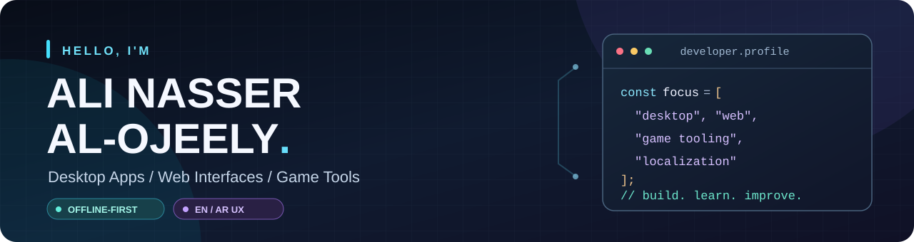

<strong>Building practical, polished software - from desktop utilities to browser-based game tools.</strong>

## About Me

I'm **Ali Nasser Al-Ojeely**, a software developer focused on **desktop applications, frontend development, and game-related tools**. I enjoy turning complex workflows into clean, useful interfaces - especially software that is **offline-first, privacy-conscious, and accessible in both English and Arabic**.

My work spans **Electron and Node.js**, **C#/.NET desktop applications**, **React web interfaces**, and **C++ systems programming**. Lately, I have been exploring **native graphics integration, browser-based emulation, localization workflows, and automated testing**.

## Featured Projects

<table>
  <tr>
    <td width="50%" valign="top">
      <h3><a href="https://github.com/AliAl-ojeely/nexus-game-launcher">Nexus Game Launcher</a></h3>
      A local PC-game library manager featuring playtime and session analytics, bilingual UI, and an <strong>experimental</strong> in-game overlay.  
      <strong>Electron | Node.js | JavaScript | C++ (overlay experiments)</strong>
    </td>
    <td width="50%" valign="top">
      <h3><a href="https://github.com/AliAl-ojeely/Neo-Geo-Web">Neo-Geo Web Port</a></h3>
      An offline-capable, bilingual browser frontend for personal Neo Geo libraries, using EmulatorJS and FBNeo/WebAssembly. Users provide their own game files.  
      <strong>JavaScript | Python | WebAssembly | EmulatorJS</strong>
    </td>
  </tr>
  <tr>
    <td width="50%" valign="top">
      <h3><a href="https://github.com/AliAl-ojeely/Arabic-L10-Hub">Arabic L10 Hub</a></h3>
      A noncommercial web platform for organizing and sharing Arabic game-localization patches, with responsive pages and right-to-left design.  
      <strong>React | Vite | CSS Modules | GitHub Pages</strong> 
      <a href="https://alial-ojeely.github.io/Arabic-L10-Hub/">Live website</a>
    </td>
    <td width="50%" valign="top">
      <h3><a href="https://github.com/AliAl-ojeely/Game-Translator">Game Translator</a></h3>
      A privacy-focused Windows localization utility for JSON game text, with a WPF interface and support for local LLM endpoints.  
      <strong>C# | .NET 8 | WPF | MVVM</strong>
    </td>
  </tr>
  <tr>
    <td width="50%" valign="top">
      <h3><a href="https://github.com/AliAl-ojeely/CMD-Vault">CMD Vault</a></h3>
      A fully offline English/Arabic command reference for Windows, Linux, and macOS, with searchable explanations and copy-ready commands.  
      <strong>Electron | JavaScript | Cross-platform desktop</strong>
    </td>
    <td width="50%" valign="top">
      <h3><a href="https://github.com/AliAl-ojeely/SnipSave">SnipSave</a></h3>
      A Windows screenshot utility that automatically saves Snipping Tool captures, prevents duplicates, and supports a system tray and bilingual interface.  
      <strong>C# | .NET 8 | WPF | Windows APIs</strong>
    </td>
  </tr>
</table>

### More Projects

- **[TempCleaner](https://github.com/AliAl-ojeely/TempCleaner)** - Windows cleanup utility built with C# and WPF.
- **[Folder Notifier](https://github.com/AliAl-ojeely/Folder-Notifier)** - Offline folder notes and Explorer integration with a bilingual WPF UI.
- **[Inno Setup Installer Template](https://github.com/AliAl-ojeely/InnoSetup-Game-Installer-Template)** - Customizable Windows installer scripts with detailed progress reporting.
- **[Bank System (C++)](https://github.com/AliAl-ojeely/Bank_System_OOP)** - Console banking project built around OOP, modularity, and access permissions.

## Technology & Tools

  

 

| Area | Technologies and practices |
| :--- | :--- |
| **Desktop development** | Electron, Node.js, C#/.NET, WPF, Windows Forms, Windows APIs |
| **Frontend engineering** | React, Vite, JavaScript, HTML, CSS, responsive UI, Arabic RTL interfaces |
| **Game tools and systems** | C++, OOP, DXGI/DirectX experiments, FBNeo/WebAssembly, Inno Setup |
| **Automation and quality** | Python, Git/GitHub, GitHub Actions, JSON/CSV workflows, automated tests |

## Currently Exploring

- **Game overlays and native integration** - Bridging Electron-rendered interfaces with C++ graphics hooks; the Nexus overlay remains experimental, with DirectX 12 support still incomplete.
- **Offline-first browser technology** - WebAssembly-powered game tooling, local-file workflows, and resilient offline experiences.
- **Game localization engineering** - Arabic text pipelines, RTL usability, translation QA, and modding utilities.
- **Software architecture** - Deepening C++/C# OOP skills and studying SQL and data modeling.

## GitHub Snapshot

  
  

  Languages shown are based on public repository statistics, not a measure of proficiency.
  
<strong>Interested in building useful tools, improving developer workflows, and making software more accessible.</strong>

  <a href="https://github.com/AliAl-ojeely?tab=repositories">Explore all repositories</a> | <a href="mailto:alialojeely@gmail.com">Contact me</a>

