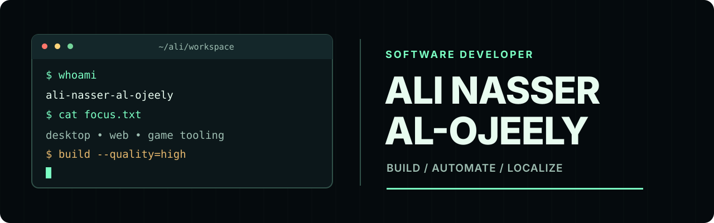
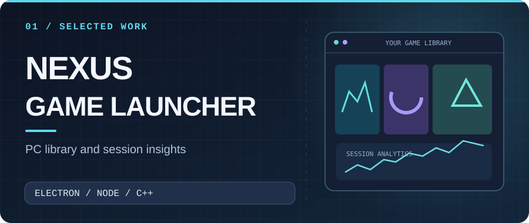
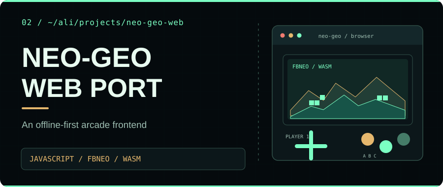
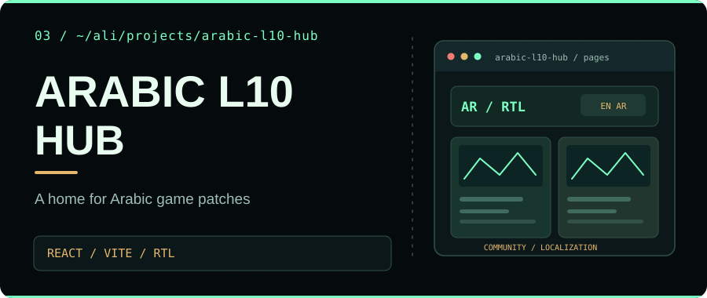
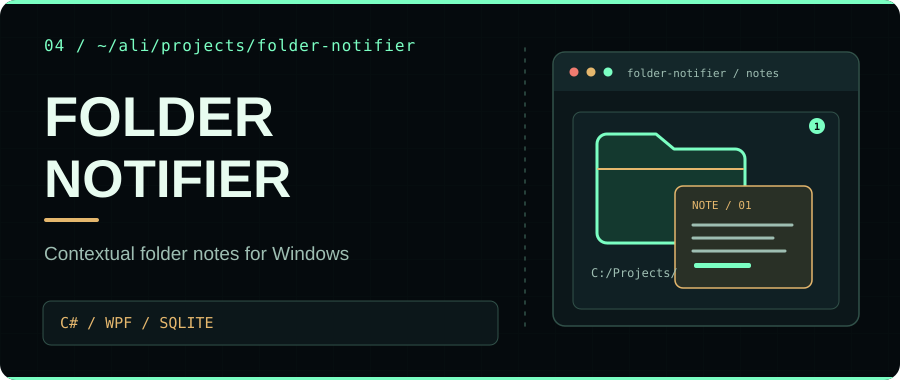

<!-- GitHub Profile README | Personal brand: Terminal Noir / Mint / Warm Gold -->

<picture>
  <source media="(prefers-color-scheme: dark)" srcset="assets/profile-hero-dark.svg">
  <source media="(prefers-color-scheme: light)" srcset="assets/profile-hero-light.svg">
  
</picture>

 

<strong>DESKTOP ENGINEERING &nbsp; / &nbsp; WEB EXPERIENCES &nbsp; / &nbsp; GAME TOOLING</strong>

  I build <strong>offline-first applications</strong>, thoughtful interfaces, and tools that make complex workflows feel simple.

---

### 01 / ABOUT

I'm **Ali Nasser Al-Ojeely**, a software developer focused on **desktop applications, frontend engineering, and game-related tools**. I work across **Electron + Node.js**, **C# / .NET / WPF**, **React**, and **C++** to build software with clear interfaces and practical purpose.

I care about three things in particular: **local-first design**, **English/Arabic experiences with proper RTL support**, and **reliable engineering** - from modular architecture to testing and diagnostics.

> **Current direction:** Going deeper into desktop and native integration, browser-based emulation with WebAssembly, game localization workflows, and OOP/system design. DirectX-based in-game overlays are still experimental work, not a finished cross-game feature.

### 02 / SELECTED WORK

A selection of projects that represent what I build - click any card to explore the source.

<table>
  <tr>
    <td width="50%" valign="top">
      
      <h3><a href="https://github.com/AliAl-ojeely/nexus-game-launcher">Nexus Game Launcher</a></h3>
      
An English/Arabic PC game library manager with session tracking, playtime analytics, and a customizable desktop interface. Native in-game overlay experiments remain <strong>in development</strong>.

      <strong>Electron &middot; Node.js &middot; JavaScript &middot; C++ (experimental)</strong>
      
<a href="https://github.com/AliAl-ojeely/nexus-game-launcher">Source &amp; documentation</a>

    </td>
    <td width="50%" valign="top">
      
      <h3><a href="https://github.com/AliAl-ojeely/Neo-Geo-Web">Neo-Geo Web Port</a></h3>
      
An offline-capable browser frontend for a personal Neo Geo collection, with English/Arabic UI, local ROM/BIOS selection, custom controls, and FBNeo running through WebAssembly.

      <strong>JavaScript &middot; Python &middot; EmulatorJS &middot; FBNeo / WebAssembly</strong>
      
<a href="https://github.com/AliAl-ojeely/Neo-Geo-Web">Source &amp; documentation</a>

    </td>
  </tr>
  <tr>
    <td width="50%" valign="top">
      
      <h3><a href="https://github.com/AliAl-ojeely/Arabic-L10-Hub">Arabic L10 Hub</a></h3>
      
A nonprofit, Arabic-first platform for preserving and sharing fan-made game localization patches. Built with responsive pages, reusable components, and right-to-left layouts.

      <strong>React &middot; Vite &middot; CSS Modules &middot; GitHub Pages</strong>
      
<a href="https://alial-ojeely.github.io/Arabic-L10-Hub/">Live website</a> &nbsp; | &nbsp; <a href="https://github.com/AliAl-ojeely/Arabic-L10-Hub">Source</a>

    </td>
    <td width="50%" valign="top">
      
      <h3><a href="https://github.com/AliAl-ojeely/Folder-Notifier">Folder Notifier</a></h3>
      
A privacy-first Windows utility that attaches notes to folders and displays them through Explorer integration. Features a local SQLite database, system tray controls, and English/Arabic RTL support.

      <strong>C# &middot; .NET 8 &middot; WPF &middot; SQLite &middot; Windows Shell</strong>
      
<a href="https://github.com/AliAl-ojeely/Folder-Notifier">Source &amp; documentation</a>

    </td>
  </tr>
</table>

### 03 / MORE SOFTWARE I'VE BUILT

| Project | What it does | Stack |
| :--- | :--- | :--- |
| [**CMD Vault**](https://github.com/AliAl-ojeely/CMD-Vault) | Offline, bilingual command reference for Windows, Linux, and macOS | Electron, JS |
| [**SnipSave**](https://github.com/AliAl-ojeely/SnipSave) | Automatically saves Windows Snipping Tool screenshots with duplicate protection | C#, WPF |
| [**TempCleaner**](https://github.com/AliAl-ojeely/TempCleaner) | Windows cleanup utility with an English/Arabic UI | C#, .NET 8 |
| [**Click2Key**](https://github.com/AliAl-ojeely/Click2Key) | Windows keyboard shortcut utility with optional delays and tray support | C#, WinForms |
| [**Inno Setup Game Installer**](https://github.com/AliAl-ojeely/InnoSetup-Game-Installer-Template) | Customizable installer scripts with precise progress and time estimates | Inno Setup |
| [**Bank System (OOP)**](https://github.com/AliAl-ojeely/Bank_System_OOP) | A modular C++ console banking system applying OOP principles | C++ |

<a href="https://github.com/AliAl-ojeely?tab=repositories"><strong>View all public repositories</strong></a>

### 04 / THE TOOLKIT

  
   
  Desktop applications &nbsp;&middot;&nbsp; Web interfaces &nbsp;&middot;&nbsp; Game tooling &nbsp;&middot;&nbsp; Automation &amp; localization

### 05 / WHAT I'M EXPLORING NOW

- **Desktop + graphics:** Experimenting with native graphics interop and a configurable in-game overlay for Nexus. DirectX 12 support is not yet complete.
- **Web emulation + offline reliability:** Improving Neo-Geo Web Port's local assets, controller support, and offline installation workflows.
- **Arabic software localization:** Creating translation pipelines, verification tools, and accessible bilingual experiences.
- **Engineering fundamentals:** Strengthening OOP, C# architecture, SQL fundamentals, and testing practices.

  
<strong>06 / GITHUB ACTIVITY - VIEW STATS</strong>

   
  

    <picture>
      <source media="(prefers-color-scheme: light)" srcset="https://github-readme-stats.vercel.app/api?username=AliAl-ojeely&amp;show_icons=true&amp;bg_color=EEF1EF&amp;title_color=088A64&amp;text_color=16282A&amp;icon_color=CF7924&amp;border_color=BACDCA" />
      
    </picture>
    <picture>
      <source media="(prefers-color-scheme: light)" srcset="https://github-readme-stats.vercel.app/api/top-langs/?username=AliAl-ojeely&amp;layout=compact&amp;bg_color=EEF1EF&amp;title_color=088A64&amp;text_color=16282A&amp;border_color=BACDCA" />
      
    </picture>
    
Repository language distribution is not a proficiency ranking. Cards depend on a third-party service.

  

 

  <code>~/ali/workspace $ build --quality=high</code> &nbsp;&middot;&nbsp; Designed to be useful. Built to keep getting better.

